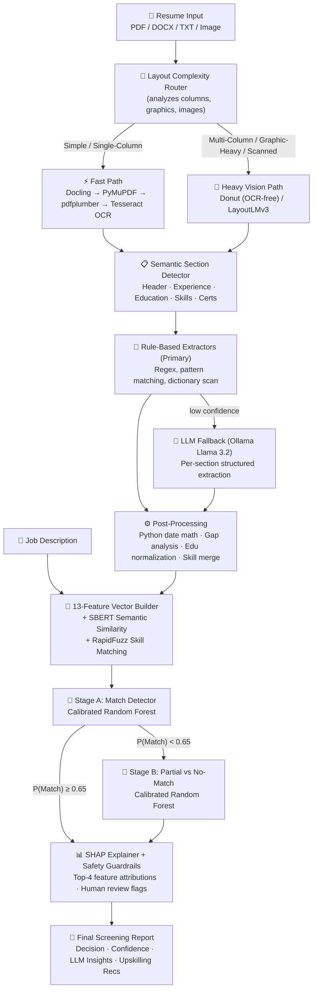

# PROJECT SYNOPSIS

## NLP-Integrated Resume Shortlister: An AI-Driven Candidate Screening System

---

| | |
|---|---|
| **Project Title** | NLP-Integrated Resume Shortlister |
| **Domain** | Natural Language Processing · Machine Learning · Intelligent Automation |
| **Academic Year** | 2024–25 |

### Team Members

| Name | Roll Number |
|---|---|
| Vivaan Mishra | 2024Btech226 |
| Satvik Agarwal | 2024Btech190 |
| Kartik Sharma | 2024Btech092 |
| Mohit Khurana | 2024Btech155 |

---

### 1. Problem Statement

Manual resume screening is one of the most time-consuming bottlenecks in the recruitment pipeline. Recruiters typically spend 6–8 seconds per resume, leading to inconsistent evaluations, unconscious bias, and the frequent rejection of qualified candidates. Existing keyword-matching tools (ATS systems) are brittle — they fail on format variations, miss semantic equivalences (e.g., "ML" vs "Machine Learning"), and cannot reason about experience relevance. There is a clear need for an **intelligent, explainable, and format-agnostic** screening system that can understand resumes the way a human recruiter does, but at scale.

### 2. Objective

To design and implement an end-to-end automated resume screening system that:
- Parses resumes in **any format** (PDF, DOCX, TXT, scanned images) using layout-aware document intelligence.
- Extracts structured candidate information (skills, experience, education) via a **hybrid LLM + rule-based** extraction pipeline.
- Matches candidates against job descriptions using a **13-feature ML model** with calibrated confidence scores.
- Provides **explainable decisions** (SHAP-based feature impact) so recruiters understand *why* a candidate was matched or rejected.
- Flags borderline cases for **human review** instead of making overconfident incorrect decisions.

### 3. Proposed Methodology

The system operates as a **four-stage pipeline**:

1. **Document Parsing (Layout-Aware):** A **Layout Complexity Router** first analyzes each resume's spatial geometry (column count, vector drawings, embedded images) to classify it as simple or complex. Simple single-column documents take a **fast path** through Docling → PyMuPDF → pdfplumber → Tesseract OCR (multi-fallback chain). Complex, graphic-heavy, or infographic-style resumes are routed to a **heavy vision path** powered by **Donut** (OCR-free visual document understanding) or **LayoutLMv3** (layout-aware transformer). This dual-path design ensures near-100% format coverage.

2. **Structured Extraction (Hybrid NLP):** The parsed text is split into semantic sections (Experience, Education, Skills, etc.) using header detection. Each section is processed by **deterministic rule-based extractors** (regex, pattern matching) as the primary method. A **locally-hosted LLM (Llama 3.2 via Ollama)** is invoked as a fallback only when rules return low-confidence results. Experience durations are calculated deterministically in Python (not by the LLM) to avoid hallucinated arithmetic.

3. **Feature Engineering & ML Classification:** A 13-dimensional feature vector is constructed, capturing skill match score, experience ratio, semantic similarity (via Sentence-BERT), domain alignment, and boundary-aware features (skill gap, experience gap, skill balance ratio). This vector is evaluated by a **two-stage cascade Random Forest classifier** — Stage A detects confident matches; Stage B distinguishes partial matches from non-matches. Both stages use **Platt-scaled calibrated probabilities** for honest confidence scores.

4. **Explainable Report Generation:** The final output includes the match decision, confidence percentage, SHAP-based top factors driving the decision, qualitative LLM-generated hiring insights (strengths, gaps, career trajectory), and upskilling recommendations for missing skills.

### 4. System Architecture

### 5. Key Technologies

| Layer | Technology |
|---|---|
| Document Parsing | Docling, PyMuPDF, pdfplumber, Tesseract OCR |
| Vision Models | Donut (naver-clova-ix/donut-base-vqa), LayoutLMv3 |
| NLP & LLM | Ollama (Llama 3.2 — runs locally), Sentence-BERT |
| ML Classification | scikit-learn (Random Forest + CalibratedClassifierCV) |
| Explainability | SHAP (TreeExplainer) |
| Skill Matching | RapidFuzz (fuzzy string matching) |
| Language | Python 3.13 |

### 6. Key Features & Novelty

- **Privacy-First:** The LLM (Llama 3.2) runs entirely on the user's local machine via Ollama — no resume data is sent to external APIs.
- **Graceful Degradation:** Every component has a fallback — LLM unavailable → rule-based extraction; Docling fails → PyMuPDF → pdfplumber → OCR; complex layouts → Donut/LayoutLMv3 vision path. The system never hard-fails.
- **Dual-Path Routing:** A Layout Complexity Router intelligently routes simple resumes through a fast text-extraction path, while graphic-heavy or infographic-style resumes are handled by Donut (OCR-free visual document understanding) for accurate parsing.
- **Calibrated Confidence:** Unlike typical classifiers that output raw probabilities, our model uses Platt scaling to produce **honestly calibrated** confidence scores, and flags near-tie decisions (margin < 10%) for human review.
- **13-Feature Engineering:** Three novel boundary-aware features (skill gap signed, experience gap years, skill balance ratio) improve the model's ability to distinguish partial matches from clear matches/rejects.
- **Explainability:** SHAP feature attribution provides recruiters with the *reasons* behind each decision, not just a score.

### 7. Expected Outcomes

- Automated screening of resumes with **~82% accuracy** at the chosen confidence threshold.
- Reduction in recruiter screening time by an estimated **70–80%**.
- Transparent, explainable match/reject decisions with confidence scores and factor analysis.
- A robust, format-agnostic system that handles real-world resume diversity (multi-column PDFs, scanned documents, varied formatting).

### 8. Conclusion

The NLP-Integrated Resume Shortlister bridges the gap between simplistic keyword-matching ATS tools and the nuanced judgement of human recruiters. By combining layout-aware document parsing, local LLM-powered extraction, calibrated machine learning, and SHAP explainability into a unified pipeline, the system delivers fast, fair, and transparent candidate screening — while keeping all data private and all decisions interpretable.

---
